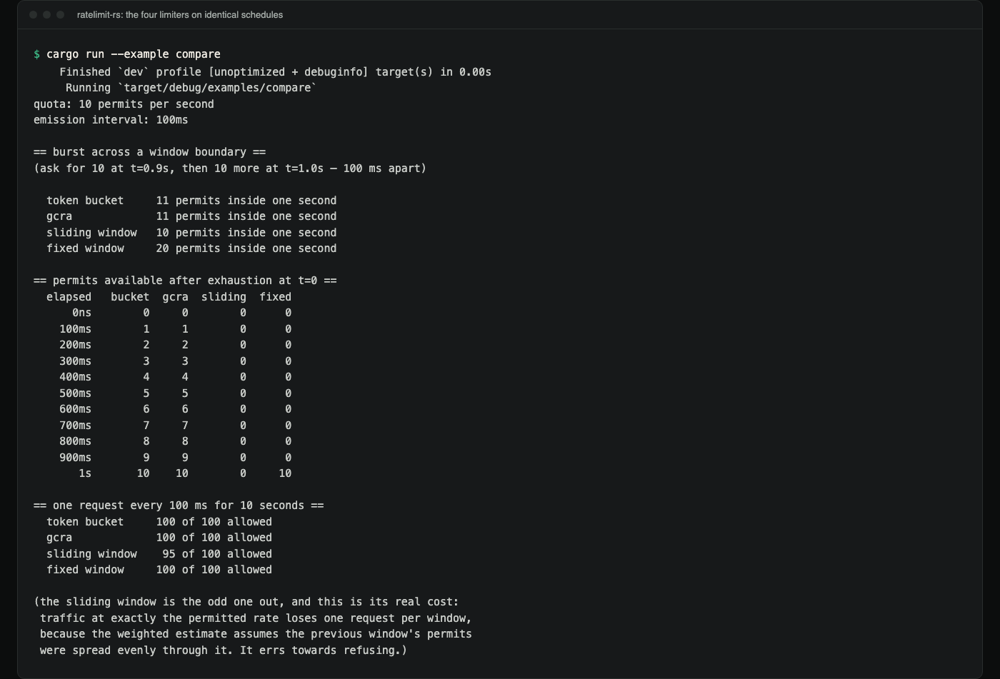
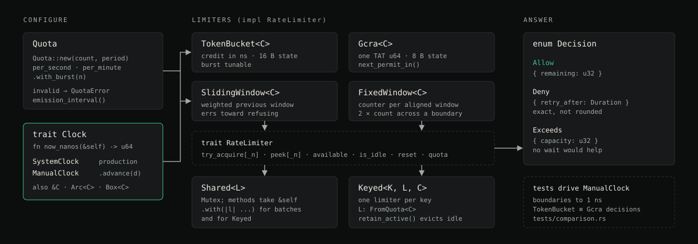

# ratelimit-rs

[](https://github.com/hellpuffyt/ratelimit-rs/actions/workflows/ci.yml)

A Rust library with four rate limiters (token bucket, GCRA, sliding window
and fixed window) behind one `RateLimiter` trait, one `Quota` type and one
injectable `Clock`. It has no runtime dependencies.

**Status:** version 0.1.0, std-only, MSRV 1.70. CI runs the tests on
stable, a 1.70 build check, clippy, rustfmt and a byte-for-byte check of
the example output below.

This crate is **not published on crates.io**: the name `ratelimit-rs`
there belongs to an unrelated project, so `ratelimit-rs = "0.1"` would
fetch someone else's code. Depend on this repository directly:

```toml
[dependencies]
ratelimit-rs = { git = "https://github.com/hellpuffyt/ratelimit-rs" }
```

The library is imported as `ratelimit`.

```rust
use std::time::Duration;
use ratelimit::{Decision, Quota, RateLimiter, TokenBucket};

// 100 requests per minute, but up to 10 may arrive at once.
let quota = Quota::per_minute(100)?.with_burst(10)?;
let mut limiter = TokenBucket::new(quota);

match limiter.try_acquire() {
    Decision::Allow { remaining } => println!("served; {remaining} left"),
    Decision::Deny { retry_after } => println!("429; retry in {retry_after:?}"),
    Decision::Exceeds { capacity } => println!("400; the most we ever allow is {capacity}"),
}
```

The snippets in this README use `?` on the `Quota` constructors, so they
belong inside a function that returns a `Result`.

## Demo



*Real terminal capture of `cargo run --example compare`, which drives all
four limiters on a `ManualClock`. The same output is reproduced as text in
[Real, observed output](#real-observed-output).*

## Design

Most rate-limiter crates implement one algorithm, read `Instant::now()`
directly, and test with `thread::sleep`. This crate is built around three
choices that avoid those limits:

1. **Four algorithms behind one trait.** Picking a token bucket over a
   sliding window should be based on what each lets through, so all four
   implement `RateLimiter` and take the same `Quota`. The comparison table
   below is backed by `tests/comparison.rs`, which drives all four through
   identical schedules on the same manual clock and asserts the
   differences. It also checks the one real equivalence: a token bucket and
   a GCRA with matching parameters return identical decisions over
   randomized schedules.

2. **Injected time.** Bugs in a rate limiter sit at boundaries: one
   nanosecond either side of a window rollover, the instant a bucket is
   exactly empty. A test that sleeps 50 ms and checks "roughly the right
   number" cannot see them. Every limiter reads time through the `Clock`
   trait, and the tests advance a `ManualClock` by exact `Duration`s, down
   to `Duration::from_nanos(1)`. The full suite runs in under a second of
   test time and does not depend on the OS scheduler.

3. **Conservation checks, not just "doesn't panic".** A token bucket must
   never grant more than `burst + rate * elapsed` permits however it is
   called. The tests check that bound with up to 8 threads sharing one
   `Mutex`-guarded limiter, against a frozen or precisely advanced clock,
   plus adversarial cases: a clock that goes backwards, a batch larger than
   the burst, callers racing a window boundary.

`ManualClock` is public, so your own service code (the retry path, the
queue behind a 429) can be tested the same way.

## Structure

Diagram of the public types and how they fit together (a drawing, not a
screenshot):



## The four algorithms, and when to reach for which

All four enforce the same long-run rate. They differ in what they let
through in the short run, which is the only thing that matters when
choosing between them:

| | Burst at one instant | Recovery after exhaustion | Worst case in any window-length span | State beyond `Quota` and clock |
| --- | --- | --- | --- | --- |
| `TokenBucket` | `burst`, tunable | one permit every `period / count` | `burst + count` | 16 bytes |
| `Gcra` | `burst`, tunable | one permit every `period / count` | `burst + count` | 8 bytes |
| `SlidingWindow` | `count` | released continuously as the old window ages out | `2 * count` if a burst is aimed at the end of a window, less otherwise | 16 bytes |
| `FixedWindow` | `count` | nothing, then all of it at the boundary | `2 * count` | 16 bytes (12 + padding) |

- **`TokenBucket`**: the default. Absorbs the bursts real clients produce
  while holding the average, and `burst` is a dial you can set independently
  of the rate (`with_burst(1)` makes it a strict pacer that never allows two
  permits at once).
- **`Gcra`**: the same decisions as `TokenBucket` in half the state (one
  `u64` instead of two), and it knows *when* the next permit falls due
  (`next_permit_in`), which is what a scheduler wants instead of a bare
  allow/deny.
- **`SlidingWindow`**: use it when the limit is a promise about a named window
  ("600 per minute") that has to hold for *every* minute-long span, not just
  ones aligned to a clock boundary. Costs an approximation that errs toward
  refusing: traffic at exactly the permitted rate loses about one request in
  twenty (see below), because the weighted estimate assumes the previous
  window's permits were spread evenly through it.
- **`FixedWindow`**: use it when the boundary is part of the contract: a billing
  period, a daily allowance. Cheapest of the four, easiest to explain to a
  support ticket, and lets a client take `2 * count` across a boundary,
  which is fine when the boundary is real and unacceptable when it isn't.

### Real, observed output

This is the output of `cargo run --example compare`. It shows the same
behaviour `tests/comparison.rs` asserts, and CI diffs it byte for byte
against `tests/fixtures/compare-output.txt`:

```
$ cargo run --example compare
quota: 10 permits per second
emission interval: 100ms

== burst across a window boundary ==
(ask for 10 at t=0.9s, then 10 more at t=1.0s — 100 ms apart)

  token bucket     11 permits inside one second
  gcra             11 permits inside one second
  sliding window   10 permits inside one second
  fixed window     20 permits inside one second

== permits available after exhaustion at t=0 ==
  elapsed   bucket  gcra  sliding  fixed
      0ns        0     0        0      0
    100ms        1     1        0      0
    200ms        2     2        0      0
    300ms        3     3        0      0
    400ms        4     4        0      0
    500ms        5     5        0      0
    600ms        6     6        0      0
    700ms        7     7        0      0
    800ms        8     8        0      0
    900ms        9     9        0      0
       1s       10    10        0     10

== one request every 100 ms for 10 seconds ==
  token bucket     100 of 100 allowed
  gcra             100 of 100 allowed
  sliding window    95 of 100 allowed
  fixed window     100 of 100 allowed

(the sliding window is the odd one out, and this is its real cost:
 traffic at exactly the permitted rate loses one request per window,
 because the weighted estimate assumes the previous window's permits
 were spread evenly through it. It errs towards refusing.)
```

In the first block the fixed window grants 20 permits inside one second
because the burst straddles its boundary. The token bucket and GCRA grant
11: the full burst of 10 plus the one permit that refilled in the 100 ms
gap. Lowering their burst with `with_burst` would tighten that; the
windows have no such setting.

## Time is injected

No limiter calls `std::time::Instant::now()` internally. They read a
`Clock` trait, which in production is `SystemClock` and in tests is
`ManualClock`:

```rust
use std::time::Duration;
use ratelimit::{Clock, ManualClock};

let clock = ManualClock::new();
assert_eq!(clock.now_nanos(), 0);
clock.advance(Duration::from_millis(250));
assert_eq!(clock.now_nanos(), 250_000_000);
```

The same mechanism is available to you. If your service's behaviour under a
rate limit is worth testing (the retry path, the 429 handler, the queue
that backs up), drive your limiter from a `ManualClock` and test it in
microseconds instead of `tokio::time::sleep`.

## Shared and per-key use

Limiters take `&mut self`, so sharing is explicit:

```rust
use ratelimit::{Shared, TokenBucket, Quota};
let limiter = Shared::new(TokenBucket::new(Quota::per_second(100)?));
// limiter.try_acquire() now takes &self, safe to call from any thread.
```

`Keyed<K, L, C>` builds one limiter per key on first sight of it, for the
more common shape of a rate limit: "10 per second *each*", not "1000 per
second total". `Keyed` methods take a key, so it is not itself a
`RateLimiter`; share it across threads with `Shared::with`:

```rust
use std::net::IpAddr;
use ratelimit::{Gcra, Keyed, Quota, Shared};

// 10 per second for each client IP, callable from any thread.
let per_ip = Shared::new(Keyed::<IpAddr, Gcra>::new(Quota::per_second(10)?));
let ip: IpAddr = "203.0.113.7".parse().unwrap();
let decision = per_ip.with(|limiters| limiters.try_acquire(ip));
```

`Keyed::retain_active` evicts keys whose limiters have fully recovered, so
a per-IP table does not grow without bound.

## Correctness under burst load

`tests/token_bucket.rs`, `tests/gcra.rs`, `tests/sliding_window.rs` and
`tests/fixed_window.rs` each carry the same shape of coverage: exhaustion,
recovery, boundary nanoseconds, batch (`_n`) requests, a backwards clock,
and concurrent access. `Shared<L>` is hammered from up to 8 threads at once (a mix of
single- and multi-permit requests) against a frozen or precisely-advanced
clock, and the number of permits granted is checked against the *exact*
expected total for that interleaving, not a range or "didn't over-allow by
much." `tests/comparison.rs` adds 20,000-step randomized-schedule tests
proving `TokenBucket` and `Gcra`
return byte-identical decisions, including the exact `retry_after` on every
refusal, for any clock that keeps the documented monotonic contract, and
shows exactly where that equivalence breaks (a clock that goes backwards).

`tests/properties.rs` adds randomized property tests over reproducible
seeds: every limiter is checked against an independent reference model
(the window models recompute their counts from a full log of grants),
every `retry_after` is checked to be exact (waiting that long succeeds,
one nanosecond less does not), a clock that steps backwards is checked
never to mint permits, and quotas and clock readings at the extremes of
the `u64` nanosecond range are checked never to overflow or fail open.

Run it yourself:

```
$ cargo test --all-targets
$ cargo test --doc
```

On 2026-10-25 that was 171 passing tests across the unit and integration
targets plus 12 doctests, with none failed or ignored (see also
[`docs/PRODUCTION_READINESS.md`](docs/PRODUCTION_READINESS.md)).

## No dependencies

The crate is `std`-only, with no optional features. A rate limiter sits in
front of everything else a service does, so a compromised dependency there
would sit in front of everything too.

## MSRV

Rust 1.70. CI builds all targets with 1.70; the tests run on stable.

## Limitations

- GCRA cannot represent a schedule that runs past `u64::MAX` nanoseconds
  of its clock (over 584 years after the clock's epoch). A request whose
  schedule would end there is refused with `retry_after: Duration::MAX`
  rather than admitted: it fails closed. `SystemClock` starts at zero
  when created, so this only concerns custom clocks with a far-future
  epoch.
- A clock that steps backwards is absorbed, never rewarded: the bucket
  and GCRA ignore the lost time, and the window limiters stay in the
  latest window they have seen (the sliding window charges the previous
  window as if at the start of that window). `retry_after` values given
  while the clock is behind are measured from the backwards reading.
- `Shared` is a plain `Mutex`; there is no lock-free variant.

## Security

See [SECURITY.md](SECURITY.md) for how to report a vulnerability.

## Contributing

See [CONTRIBUTING.md](CONTRIBUTING.md).

## License

MIT. See [LICENSE](LICENSE).
